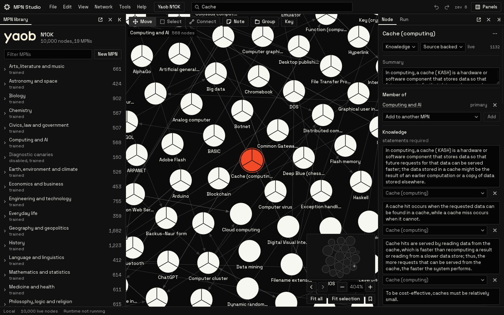

<p align="center">
  <picture>
    <source media="(prefers-color-scheme: dark)" srcset="web/public/brand/fylume/fylume-symbol-white.svg">
    
  </picture>
</p>

<h1 align="center">MPN Studio</h1>

<p align="center">
  A native Linux desktop workbench for <b>Modular Persistent Networks</b>.<br>
  Edit a network of thousands of knowledge nodes on a visual whiteboard, on your own computer, with no internet.
</p>

<p align="center">
  <a href="https://github.com/sarja-technologies/mpn-studio/releases/latest"><b>Download</b></a> ·
  <a href="docs/desktop/BUILD.md">Build from source</a> ·
  <a href="docs/desktop/ARCHITECTURE.md">Architecture</a> ·
  <a href="https://yaob.fylu.me">Yaob</a>
</p>



MPN Studio is the editor for [Yaob](https://github.com/sarja-technologies/yaob) networks, built by [Fylume](https://fylu.me).
A network is made of nodes. Each node has three cells, Knowledge, Thinking and Reasoning, and nodes are grouped
into MPNs (Modular Persistent Networks) by domain. The app shows the whole network at once and lets you zoom into any node.

## Download

Get the latest build from the [Releases page](https://github.com/sarja-technologies/mpn-studio/releases/latest).

| File | For |
|---|---|
| `mpn-studio_0.1.0_amd64.deb` | Ubuntu and Debian, x86_64. Adds a menu entry and opens `.mpnbak` backups |
| `MPN-Studio_0.1.0_x86_64.AppImage` | x86_64 Linux with GTK 3 and WebKitGTK 4.1, no install, no root |
| `SHA256SUMS` | Checksums for both |

```sh
sha256sum -c SHA256SUMS --ignore-missing
sudo apt install ./mpn-studio_0.1.0_amd64.deb       # then start "MPN Studio" from the menu, or run: mpn-studio
# or
chmod +x MPN-Studio_0.1.0_x86_64.AppImage && ./MPN-Studio_0.1.0_x86_64.AppImage
```

Built and tested on Ubuntu 26.04 LTS. The `.deb` needs `libwebkit2gtk-4.1-0` and `libgtk-3-0`. Other distributions are untested.
There is no Windows, macOS or ARM64 build yet.

On first launch, create a project or import a Yaob network. To get the 10,000-node N10K network, download
`yaob-n10k-0.1.0.tar.gz` from the [Yaob release](https://github.com/sarja-technologies/yaob/releases/tag/v0.1.0), unpack it,
and use **Import bundle folder** on the unpacked network folder.

## What you can do

- **See the whole network.** A WebGL board with domain clusters, zoom into any node, a minimap, saved views, and search that jumps to a node.
- **Edit it.** Create, edit and delete nodes and relations, with undo and redo. A node that belongs to several MPNs is stored once.
- **Keep it safe.** Projects live in `~/.local/share/mpn-studio/projects`. Each edit is saved as it is made, backups are checksummed `.mpnbak` files, and opening a backup always creates a new project and never overwrites one.
- **Move it around.** Import and export Yaob bundles and MPN packages, or adopt an existing store file.
- **Run the model, optionally.** Point *Settings, Compute* at a Python environment with `torch` and your own model weights and MPN Studio starts the Yaob runtime on your machine (and the training worker, if the environment sees a CUDA GPU). Or connect over SSH to another machine that runs MPN Studio, such as a DGX Spark. Without either, inference and training show as unavailable and say why.

## It works offline

The window only loads its own bundled interface. Fonts and scripts are bundled, and there is no account, telemetry or licence check.
The backend listens on `127.0.0.1` on a random port and answers only requests that carry a per-launch token.
`scripts/offline-acceptance.sh` runs the installed app in a network namespace with only loopback and records every
`connect()` it makes: none leave the machine. The results are in [`docs/desktop/ACCEPTANCE.md`](docs/desktop/ACCEPTANCE.md).

Not verified here: loading real model weights, GPU inference and training through the local runtime. The launcher is
tested with a CPU build of `torch` and a stand-in job; run `scripts/runtime-smoke.py --python <env python> --models <weights folder>`
with your own environment to check yours.

## Build from source

You need Node 22+ with pnpm, Rust 1.80+, Python 3.12+ and the WebKitGTK and GTK development packages.

```sh
scripts/release-build.sh      # tests, web interface, frozen backend, .deb and .AppImage in dist-desktop/
```

[`docs/desktop/BUILD.md`](docs/desktop/BUILD.md) lists the packages and the individual steps, including a development build that runs the source backend.

## Repository

| Path | Contents |
|---|---|
| `web/` | Svelte 5 + Vite interface and the WebGL board |
| `mpnstudio/` | Python backend: FastAPI API, SQLite store, bundles, jobs, and the Yaob runtime and training code |
| `src-tauri/` | Tauri 2 desktop shell (Rust) that starts the backend and shows the interface |
| `packaging/` | PyInstaller spec for the backend, desktop entry and MIME type for `.mpnbak` |
| `scripts/` | Release build, offline acceptance, runtime smoke test and other tooling |
| `tests/` | Backend tests |
| `docs/` | Architecture, build, acceptance evidence, formats and API notes |

## Contributing and security

See [CONTRIBUTING.md](CONTRIBUTING.md). Report vulnerabilities as described in [SECURITY.md](SECURITY.md).

## Licence

Code: [Apache License 2.0](LICENSE). Third-party components keep their own licences ([THIRD-PARTY.md](THIRD-PARTY.md)).
The Fylume and Yaob names, logos and artwork in `web/public/brand/` are not licensed for reuse ([NOTICE](NOTICE)).
The Yaob N10K network is a separate work under CC BY-SA 4.0; see the [Yaob repository](https://github.com/sarja-technologies/yaob).
