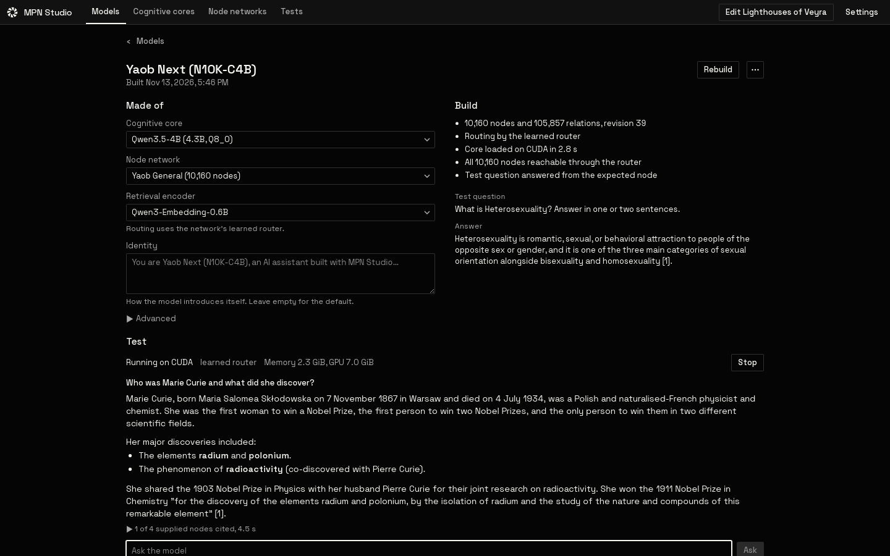

<p align="center">
  <picture>
    <source media="(prefers-color-scheme: dark)" srcset="web/public/brand/fylume/fylume-symbol-white.svg">
    
  </picture>
</p>

<h1 align="center">MPN Studio</h1>

<p align="center">
  Build your own AI models on your own Linux computer: take an open-weight language model, join it to a network of
  knowledge nodes, test it with the evidence it used, and export it as one <code>.mpn</code> file. No internet needed.
</p>

<p align="center">
  <a href="https://github.com/sarja-technologies/mpn-studio/releases/latest"><b>Download</b></a> ·
  <a href="docs/desktop/BUILD.md">Build from source</a> ·
  <a href="docs/desktop/ARCHITECTURE.md">Architecture</a> ·
  <a href="docs/MPN-FORMAT.md">The .mpn format</a> ·
  <a href="https://yaob.fylu.me">Yaob</a>
</p>



MPN Studio is the model builder for **Modular Persistent Networks** (MPN), made by [Fylume](https://fylu.me).
A model is a **cognitive core**, an open-weight language model in GGUF form used unchanged, joined to a **node
network**: thousands of knowledge nodes grouped into MPNs by domain, which the model searches before it answers and
cites in its answers. [Yaob](https://github.com/sarja-technologies/yaob) is built this way.

## Download

Get the files from the [Releases page](https://github.com/sarja-technologies/mpn-studio/releases/latest).

| File | For |
|---|---|
| `mpn-studio_0.3.0_amd64.deb` | Ubuntu and Debian on x86-64 (Intel, AMD) |
| `MPN-Studio_0.3.0_x86_64.AppImage` | Other x86-64 Linux with GTK 3 and WebKitGTK 4.1; no install, no root |
| `mpn-studio_0.3.0_arm64.deb` | Ubuntu on ARM64, including the NVIDIA DGX Spark |
| `MPN-Studio_0.3.0_aarch64.AppImage` | Other ARM64 Linux with GTK 3 and WebKitGTK 4.1 |
| `SHA256SUMS-x86_64`, `SHA256SUMS-aarch64` | Checksums |

```sh
sha256sum -c SHA256SUMS-x86_64 --ignore-missing
sudo apt install ./mpn-studio_0.3.0_amd64.deb       # menu entry "MPN Studio"; commands mpn-studio and mpn
# or
chmod +x MPN-Studio_0.3.0_x86_64.AppImage && ./MPN-Studio_0.3.0_x86_64.AppImage
```

The packages include llama.cpp builds for CPU, CUDA (NVIDIA) and, on x86-64, Vulkan, and use the first that finds a
usable device. The NVIDIA or Vulkan driver must already be installed; without a GPU, models run on the CPU.

Tested: the x86-64 packages on Ubuntu 26.04 with an RTX 4060 Ti (CUDA, Vulkan and CPU); the ARM64 packages on a
DGX Spark (GB10, Ubuntu 24.04; CUDA and CPU). Other distributions, AMD and Intel GPUs, and other ARM64 machines are
untested. There is no Windows or macOS build.

## Build a model

1. **Cognitive cores.** Import a GGUF file, or convert a Hugging Face model folder (this needs a Python with the
   converter's packages; see Settings, Compute). MPN Studio reads the architecture, size, quantization, context length
   and licence from the file. A core is stored once and shared by every model that uses it.
2. **Node networks.** Create one, import one (a Yaob release, a bundle folder or a store file), or duplicate, specialise,
   merge and compare the ones you have. **Edit** opens the network on the board: a visual editor for nodes, relations
   and MPNs, with search, undo and bulk deletion of any number of nodes in one step.
3. **Models.** Choose a core and a network (and an embedding model for retrieval, if you have one) and **Build**. The
   build checks that they fit, routes with the network's trained router if it has one and by retrieval if not, starts
   the model and asks it a test question from the network.
4. **Test.** Chat with the model. Each answer shows the nodes it read and cited, its tool calls, timing and the memory it
   uses. **Tests** runs a list of questions and saves the results. **Connect another app** gives the address, model name
   and key of the model's OpenAI-compatible API, which listens on this computer only.
5. **Export** writes one `.mpn` file: **Complete** (with the core) runs anywhere MPN Studio or `mpn` is installed,
   offline; **Lightweight** leaves the core out and finds it by its checksum.


```sh
mpn run Model.mpn --chat                          # chat in the terminal
mpn run Model.mpn                                 # OpenAI-compatible API on http://127.0.0.1:8850/v1
mpn info Model.mpn ; mpn verify Model.mpn
```

A `.mpn` file is not a GGUF file and llama.cpp alone cannot run it: the MPN runtime in MPN Studio reads it, gives the
core to llama.cpp, and does the retrieval over the network itself. See [docs/MPN-FORMAT.md](docs/MPN-FORMAT.md).

## Open an MPN network

The **MPN Network** tab (or File → Open MPN Network…) opens a whole MPN network read only, however large: nothing is
copied into a project, and every list is read a page at a time.

- **On the local network**: the address of the MPN dashboard on the computer that holds the network, for example
  `http://mpn-host.local:8844`. MPN Studio's own backend makes the requests, so the window still talks only to this
  computer.
- **On this computer**: **Install downloaded pack…** decompresses a downloaded MPN pack (format `mpn-pack/1`: zstd
  shards with SHA-256 checksums) into a folder you choose, checking every partition. **Open pack folder…** then opens it
  with no network at all.

Search titles and aliases (paged), look up a node id or a Wikidata id such as `Q42`, browse by domain, kind and source,
or show only nodes linked into another domain. The node inspector shows the KTR cells (knowledge, thinking, reasoning),
provenance with source, licence and attribution, validation, claims, relationships in both directions and a clickable
neighbourhood graph. Recently opened networks are listed for one click.

Measured on 13 November 2026 against a 119-million-node network over a 1 Gb/s LAN: search 0.08 to 0.75 s, a node 0.05 s,
its neighbourhood graph 0.25 s, a browse page 0.07 s. On a local 2.2-million-node pack: search 0.07 s, a node 0.01 s.

## Measured requirements

| | x86-64 package | ARM64 package |
|---|---|---|
| Download (`.deb` / `.AppImage`) | 853 MiB / 867 MiB | 652 MiB / 700 MiB |
| Installed (`.deb`) | 1.3 GiB | 0.9 GiB |

Most of that is NVIDIA's CUDA libraries. What a model needs depends on its core. Measured while answering:

| Model | Machine | Memory (process tree) | GPU memory | Speed |
|---|---|---|---|---|
| Qwen2.5-0.5B Q4_K_M + 3-node network | RTX 4060 Ti, CUDA | 680 MiB | 660 MiB | 240 tokens/s |
| same | i9-11900F, CPU only | | | 30 tokens/s |
| Qwen3.5-4B Q8_0 + Yaob N10K (10,160 nodes) | RTX 4060 Ti, CUDA | 2.3 GiB | 7.0 GiB | 47 tokens/s |
| same | DGX Spark GB10, CUDA | 2.2 GiB | 7.2 GiB | 45 to 47 tokens/s (core alone, 256 tokens) |

The DGX Spark is shared; its figures were measured while other jobs used the GPU. A model's `.mpn` file needs its size
again in free disk space the first time it runs (the core is extracted once, then reused).

## It works offline

The window only loads its own bundled interface. Fonts and scripts are bundled, and there is no account, telemetry or
licence check. The backend and every running model listen on `127.0.0.1` on random ports and answer only requests that
carry a per-launch token or the model's key. `mpn run` serves beyond this computer only with `--host` and an API key. The one exception you choose yourself: Open MPN
Network's "On the local network" connects the backend to the address you type.
`scripts/offline-acceptance.sh` runs the installed app in a network namespace with only loopback and records every
`connect()` it makes. A Complete `.mpn` file was run with no network at all (`bwrap --unshare-net`) on an empty library.

## Build from source

You need Node 22+ with pnpm, Rust 1.80+, Python 3.12+ and the WebKitGTK and GTK development packages. Build on the
architecture you are building for; ARM64 also needs the CUDA toolkit for its CUDA runtime.

```sh
scripts/release-build.sh      # tests, web interface, frozen backend, llama.cpp runtime, .deb and .AppImage in dist-desktop/
```

[`docs/desktop/BUILD.md`](docs/desktop/BUILD.md) lists the packages and the individual steps, how the ARM64 packages were
built on a DGX Spark without root, and a development build that runs the source backend.

## Repository

| Path | Contents |
|---|---|
| `web/` | Svelte 5 + Vite interface and the WebGL board |
| `mpnstudio/` | Python backend: FastAPI API, SQLite store, the model library (`library/`), the MPN runtime over llama.cpp (`engine/`), bundles, jobs, and the Yaob 0.1.0 PyTorch runtime and training code |
| `src-tauri/` | Tauri 2 desktop shell (Rust) that starts the backend and shows the interface |
| `packaging/` | PyInstaller spec for the backend, desktop entry, the `mpn` command, MIME types for `.mpn` and `.mpnbak` |
| `scripts/` | Release build, llama.cpp runtime fetch and CUDA build, offline acceptance and other tooling |
| `tests/` | Backend tests |
| `docs/` | Architecture, build, acceptance evidence, formats and API notes |

## Contributing and security

See [CONTRIBUTING.md](CONTRIBUTING.md). Report vulnerabilities as described in [SECURITY.md](SECURITY.md).

## Licence

Code: [Apache License 2.0](LICENSE). Third-party components keep their own licences ([THIRD-PARTY.md](THIRD-PARTY.md)),
including llama.cpp (MIT) and NVIDIA's CUDA runtime libraries (CUDA EULA). Cognitive cores are not included; each
keeps its publisher's licence, which MPN Studio shows and records in exported models.
The Fylume and Yaob names, logos and artwork in `web/public/brand/` are not licensed for reuse ([NOTICE](NOTICE)).
The Yaob N10K network is a separate work under CC BY-SA 4.0; see the [Yaob repository](https://github.com/sarja-technologies/yaob).
