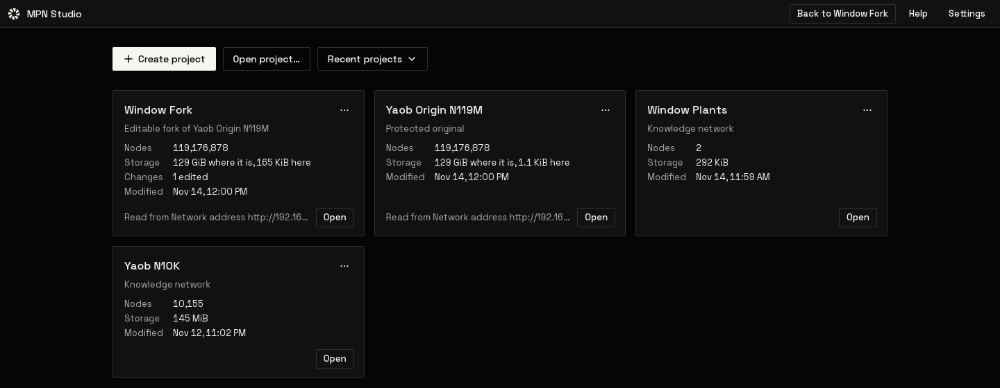
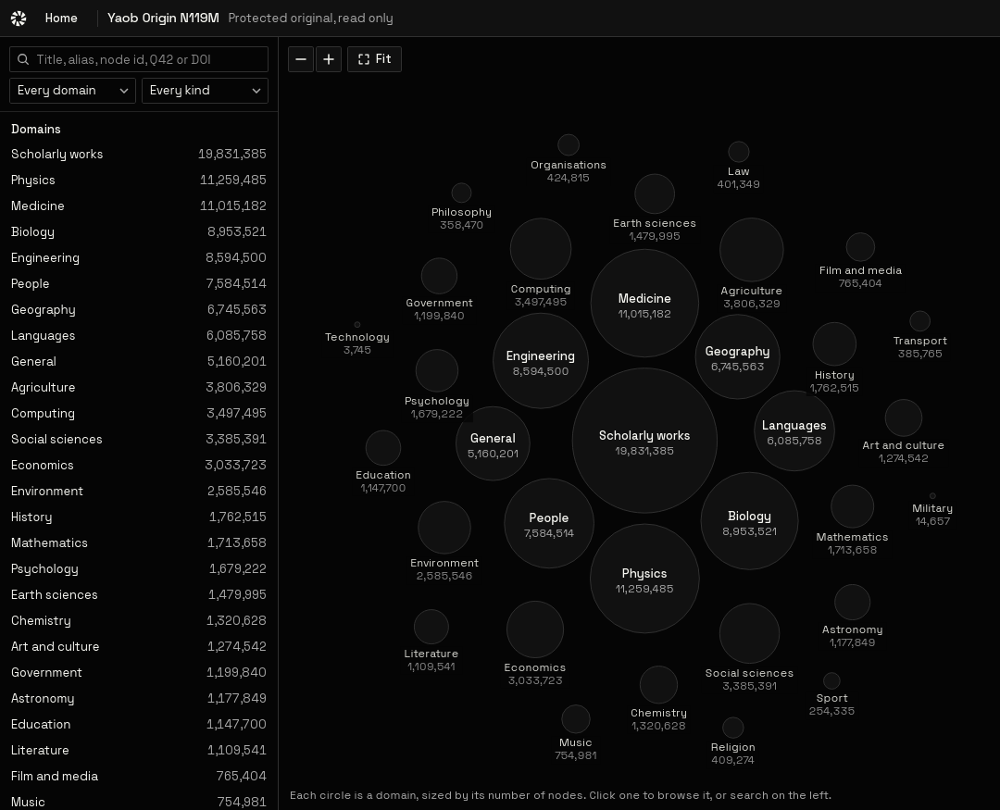
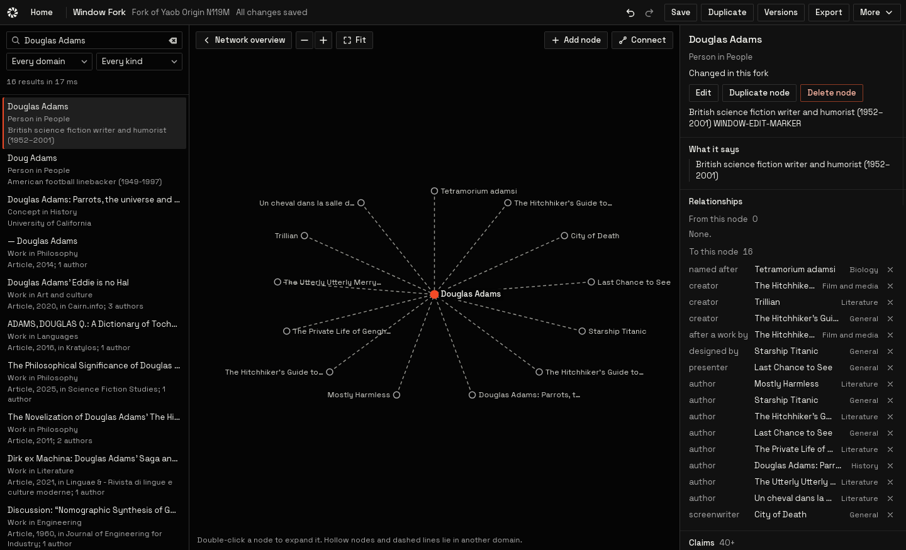

<p align="center">
  <picture>
    <source media="(prefers-color-scheme: dark)" srcset="web/public/brand/fylume/fylume-symbol-white.svg">
    
  </picture>
</p>

<h1 align="center">MPN Studio</h1>

<p align="center">
  Build your own AI models on your own Linux computer: take an open-weight language model, join it to a network of
  knowledge nodes, test it with the evidence it used, and export it as one <code>.mpn</code> file. No internet needed.
</p>

<p align="center">
  <a href="https://github.com/sarja-technologies/mpn-studio/releases/latest"><b>Download</b></a> ·
  <a href="docs/desktop/BUILD.md">Build from source</a> ·
  <a href="docs/desktop/ARCHITECTURE.md">Architecture</a> ·
  <a href="docs/MPN-FORMAT.md">The .mpn format</a> ·
  <a href="https://yaob.fylu.me">Yaob</a>
</p>


MPN Studio is the model builder for **Modular Persistent Networks** (MPN), made by [Fylume](https://fylu.me).
A model is a **cognitive core**, an open-weight language model in GGUF form used unchanged, joined to a **node
network**: thousands of knowledge nodes grouped into MPNs by domain, which the model searches before it answers and
cites in its answers. [Yaob](https://github.com/sarja-technologies/yaob) is built this way.

## Download

Get the files from the [Releases page](https://github.com/sarja-technologies/mpn-studio/releases/latest).

| File | For |
|---|---|
| `mpn-studio_0.6.0_amd64.deb` | Ubuntu and Debian on x86-64 (Intel, AMD) |
| `MPN-Studio_0.6.0_x86_64.AppImage` | Other x86-64 Linux with GTK 3 and WebKitGTK 4.1; no install, no root |
| `SHA256SUMS-x86_64` | Checksums for the x86-64 files |
| `mpn-studio_0.6.0_arm64.deb` | Ubuntu and Debian on ARM64 (NVIDIA DGX Spark and other ARMv8.2+ machines) |
| `MPN-Studio_0.6.0_aarch64.AppImage` | Other ARM64 Linux with GTK 3 and WebKitGTK 4.1 |
| `SHA256SUMS-aarch64` | Checksums for the ARM64 files |

```sh
sha256sum -c SHA256SUMS-x86_64 --ignore-missing        # or SHA256SUMS-aarch64
sudo apt install ./mpn-studio_0.6.0_amd64.deb          # menu entry "MPN Studio"; commands mpn-studio and mpn (arm64 on ARM64)
# or
chmod +x MPN-Studio_0.6.0_x86_64.AppImage && ./MPN-Studio_0.6.0_x86_64.AppImage
```

0.6 answers from FG-MPN networks: a pairing can use the 119.7 million record Yaob Origin N119M (or any FG-MPN store) with any cognitive core,
reading the store where it is, with no copy and no embeddings ([docs/fgmpn-answering.md](docs/fgmpn-answering.md)). `mpn package import` takes a Yaob package
(a folder or a zip) and makes its pairing. Yaob Origin N119M stores 280,844,705 edge rows (18,742,569 attached to nodes and 262,102,136 in-edges whose source
is not a stored node); an earlier statement of 1,693,590,449 relationships was wrong.

0.5 opens 0.4 projects as they are. It adds cognitive cores on any OpenAI-compatible server, pairings whose core can be changed without
rebuilding the network, the official releases catalogue ([docs/catalogue.md](docs/catalogue.md)), and FG-MPN networks that open out of
the box: the app carries the public [FG-MPN runtime](https://github.com/sarja-technologies/fgmpn) (see [THIRD-PARTY.md](THIRD-PARTY.md)).
[CHANGELOG.md](CHANGELOG.md) lists the changes.

The packages include llama.cpp builds for CPU, CUDA (NVIDIA) and, on x86-64, Vulkan, and use the first that finds a
usable device. The NVIDIA or Vulkan driver must already be installed; without a GPU, models run on the CPU.

Tested for 0.6.0: the headless backends of the x86-64 and ARM64 .deb packages against the live catalogue and the public Hugging Face packages, Yaob Origin N119M
answered, re-bound and imported as a package on ARM64 (also on its CUDA runtime), and the ARM64 AppImage started in a virtual display; the full window script was not run for this release. See
[docs/desktop/ACCEPTANCE.md](docs/desktop/ACCEPTANCE.md) for what was and was not run. x86-64 CUDA and Vulkan inference, other distributions and AMD and Intel GPUs are untested. There is no Windows or macOS build.

## Projects

Everything you make or open is a project, listed on the home screen with what it is, its size and where it is read
from. Nobody has to know what is inside the folder.

- **Create project**: a blank network you build yourself (add nodes, write what each one knows, connect them), a
  duplicate of a project you have, or an import of a network, bundle, backup or fork file.
- **Open project**: a project folder, an `.mpn` model, or a large network that stays where it is: a folder on this
  computer or the address of the computer that serves it (for example `http://mpn-host.local:8844`).
- **Save** is automatic: every edit is written to disk as you make it, and the top bar says so. **Undo** and **Redo**
  work across the whole history. **Versions** names the current state, compares any two states, and opens an old version
  as a new project. **Export** writes an `.mpn` model, a bundle folder, a backup, or (for a fork) an `.mpnfork` file.
- **Large networks are never copied.** A network such as Yaob Origin N119M (119 million nodes, 129 GiB) opens as a
  protected original: read only, searched and browsed a page at a time. **Duplicate to edit** makes a fork in a fraction
  of a second that stores only your changes (a few hundred kilobytes); the original is never written to.





How projects, links and forks are stored: [docs/desktop/PROJECTS.md](docs/desktop/PROJECTS.md).

## Build a model

1. **Cognitive cores.** Import a GGUF file, or convert a Hugging Face model folder (this needs a Python with the
   converter's packages; see Settings, Compute). MPN Studio reads the architecture, size, quantization, context length
   and licence from the file. A core is stored once and shared by every model that uses it.
2. **Node networks.** A project is a network: the board is a visual editor for nodes, relations and MPNs, with
   search, undo and bulk deletion of any number of nodes in one step.
3. **Models.** **Model** in the project's top bar attaches a core (and an embedding model for retrieval, if you have one)
   and **Build**s it; **More → Model library** lists every core, network and model. The
   build checks that they fit, routes with the network's trained router if it has one and by retrieval if not, starts
   the model and asks it a test question from the network.
4. **Test.** Chat with the model. Each answer shows the nodes it read and cited, its tool calls, timing and the memory it
   uses. **Tests** runs a list of questions and saves the results. **Connect another app** gives the address, model name
   and key of the model's OpenAI-compatible API, which listens on this computer only.
5. **Export** writes one `.mpn` file: **Complete** (with the core) runs anywhere MPN Studio or `mpn` is installed,
   offline; **Lightweight** leaves the core out and finds it by its checksum.


```sh
mpn run Model.mpn --chat                          # chat in the terminal
mpn run Model.mpn                                 # OpenAI-compatible API on http://127.0.0.1:8850/v1
mpn info Model.mpn ; mpn verify Model.mpn
```

A `.mpn` file is not a GGUF file and llama.cpp alone cannot run it: the MPN runtime in MPN Studio reads it, gives the
core to llama.cpp, and does the retrieval over the network itself. See [docs/MPN-FORMAT.md](docs/MPN-FORMAT.md).

## Large networks

Search titles and aliases (paged), look up a node id or a Wikidata id such as `Q42`, browse by domain, kind and source,
or show only nodes linked into another domain. The node inspector shows the KTR cells (knowledge, thinking, reasoning),
provenance with source, licence and attribution, claims, relationships in both directions with their names, and a
clickable neighbourhood graph. A linked network can have several sources (a local folder and a server address); MPN
Studio checks that each one holds the same network and falls back to the next if one is unreachable.

Measured on 14 November 2026 with Yaob Origin N119M (119,176,878 nodes): linking it took 0.09 s and its project folder is
1.1 KiB; a fork took 0.03 s and 121 KiB after an edit; a search 0.03 to 0.6 s, a node 0.02 s; the backend used under
500 MiB. With the network unreachable, a project linked to both a server and a local copy kept working from the local
copy. The Yaob Origin network itself is not part of this release.

## Measured requirements

| | x86-64 package |
|---|---|
| Download (`.deb` / `.AppImage`) | 853 MiB / 867 MiB |
| Installed (`.deb`) | 1.3 GiB |

Most of that is NVIDIA's CUDA libraries. What a model needs depends on its core. Measured while answering:

| Model | Machine | Memory (process tree) | GPU memory | Speed |
|---|---|---|---|---|
| Qwen2.5-0.5B Q4_K_M + 3-node network | RTX 4060 Ti, CUDA | 680 MiB | 660 MiB | 240 tokens/s |
| same | i9-11900F, CPU only | | | 30 tokens/s |
| Qwen3.5-4B Q8_0 + Yaob N10K (10,160 nodes) | RTX 4060 Ti, CUDA | 2.3 GiB | 7.0 GiB | 47 tokens/s |
| same | DGX Spark GB10, CUDA | 2.2 GiB | 7.2 GiB | 45 to 47 tokens/s (core alone, 256 tokens) |

The DGX Spark is shared; its figures were measured while other jobs used the GPU. A model's `.mpn` file needs its size
again in free disk space the first time it runs (the core is extracted once, then reused).

## It works offline

The window only loads its own bundled interface. Fonts and scripts are bundled, and there is no account, telemetry or
licence check. The backend and every running model listen on `127.0.0.1` on random ports and answer only requests that
carry a per-launch token or the model's key. `mpn run` serves beyond this computer only with `--host` and an API key.
The one exception you choose yourself: a project linked to a network address connects the backend to that address.
`scripts/offline-acceptance.sh` runs the installed app in a network namespace with only loopback and records every
`connect()` it makes. A Complete `.mpn` file was run with no network at all (`bwrap --unshare-net`) on an empty library.

## Build from source

You need Node 22+ with pnpm, Rust 1.80+, Python 3.12+ and the WebKitGTK and GTK development packages. Build on the
architecture you are building for; ARM64 also needs the CUDA toolkit for its CUDA runtime.

```sh
scripts/release-build.sh      # tests, web interface, frozen backend, llama.cpp runtime, .deb and .AppImage in dist-desktop/
```

[`docs/desktop/BUILD.md`](docs/desktop/BUILD.md) lists the packages and the individual steps, how the ARM64 packages were
built on a DGX Spark without root, and a development build that runs the source backend.

## Repository

| Path | Contents |
|---|---|
| `web/` | Svelte 5 + Vite interface and the WebGL board |
| `mpnstudio/` | Python backend: FastAPI API, SQLite store, the model library (`library/`), the MPN runtime over llama.cpp (`engine/`), bundles, jobs, and the Yaob 0.1.0 PyTorch runtime and training code |
| `src-tauri/` | Tauri 2 desktop shell (Rust) that starts the backend and shows the interface |
| `packaging/` | PyInstaller spec for the backend, desktop entry, the `mpn` command, MIME types for `.mpn` and `.mpnbak` |
| `scripts/` | Release build, llama.cpp runtime fetch and CUDA build, offline acceptance and other tooling |
| `tests/` | Backend tests |
| `docs/` | Architecture, build, acceptance evidence, formats and API notes |

## Contributing and security

See [CONTRIBUTING.md](CONTRIBUTING.md). Report vulnerabilities as described in [SECURITY.md](SECURITY.md).

## Licence

Code: [Apache License 2.0](LICENSE). Third-party components keep their own licences ([THIRD-PARTY.md](THIRD-PARTY.md)),
including llama.cpp (MIT) and NVIDIA's CUDA runtime libraries (CUDA EULA). Cognitive cores are not included; each
keeps its publisher's licence, which MPN Studio shows and records in exported models.
The Fylume and Yaob names, logos and artwork in `web/public/brand/` are not licensed for reuse ([NOTICE](NOTICE)).
The Yaob N10K network is a separate work under CC BY-SA 4.0; see the [Yaob repository](https://github.com/sarja-technologies/yaob).
